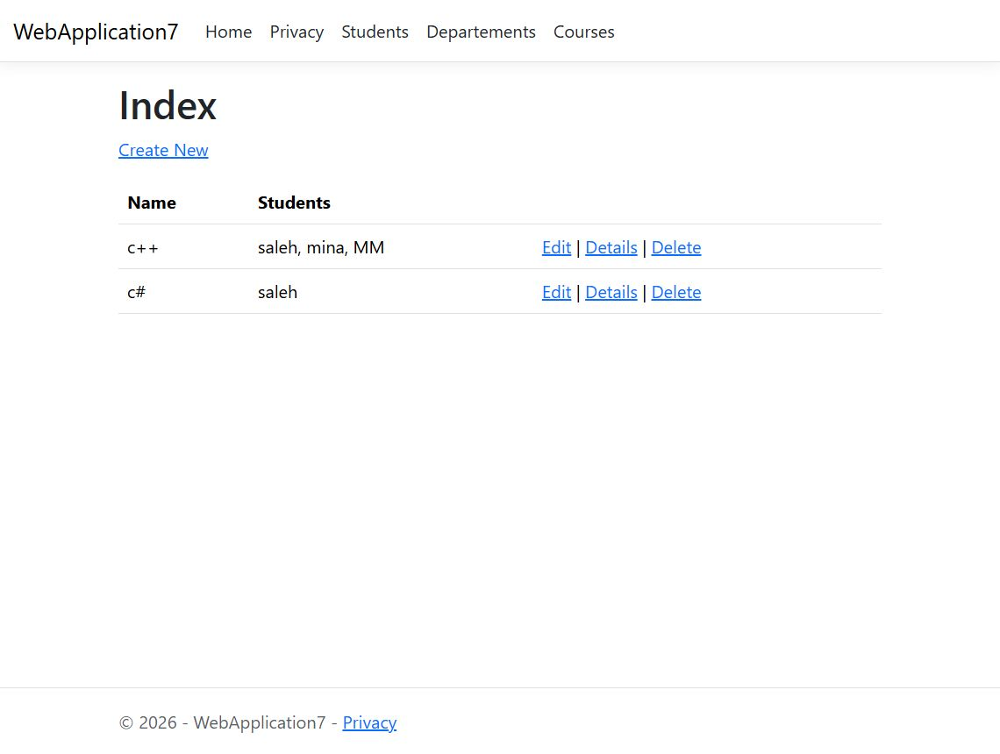
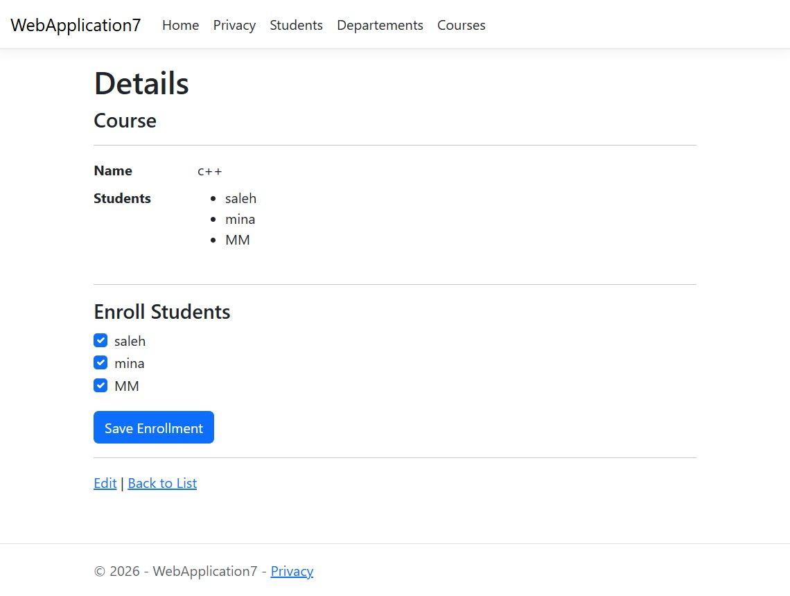

# 📚 Courses & Departments — ASP.NET Core MVC


A web application demonstrating **many-to-many relationships** in **Entity Framework Core**, with a full management system for Students, Departments and Courses.

---

## 📸 Screenshots

### Course list with enrolled students


### Many-to-many enrollment


---

## ✨ Features

- 👨‍🎓 **Students** — full CRUD with department assignment
- 🏫 **Departments** — CRUD + student count per department
- 📖 **Courses** — CRUD
- 🔗 **Many-to-Many Enrollment** — Students ↔ Courses via the automatic `CourseStudent` junction table
- ✅ **Checkbox-based enrollment** with instant feedback
- 🔍 **Eager loading** using `Include()` to avoid N+1 queries

---

## 🗄️ Data Model

```
Departement 1 ──── * Student
                       *
                       *
                       Course
```

- **Departement → Student** : one-to-many
- **Student ↔ Course** : many-to-many (EF Core junction table `CourseStudent`)

---

## 🏗️ Project Structure

```
WebApplication7/
├── Controllers/     → Student, Departement, Courses, Home
├── Models/          → Student, Departement, Course
├── Data/            → ApplicationDbContext
├── Views/           → Razor views for each controller
└── Migrations/      → EF Core migrations
```

---

## 🛠️ Tech Stack


---

## 🚀 Getting Started

```bash
# 1. Configure your connection string in appsettings.json
# 2. Apply migrations
dotnet ef database update

# 3. Run
dotnet run
```

Default connection string:
```
Server=.;Database=MyDb;Trusted_Connection=True;TrustServerCertificate=True;
```

---

## 💡 What I Learned

- Modelling **many-to-many** relationships without an explicit join entity
- Using `Include()` for eager loading related data
- Handling junction-table writes through navigation properties (`course.Students.Add(...)`)
- Structuring an MVC app with multiple controllers and views

---

## 👤 Author

**Mahmoud Saleh** — [@bodysale5678az-svg](https://github.com/bodysale5678az-svg)
